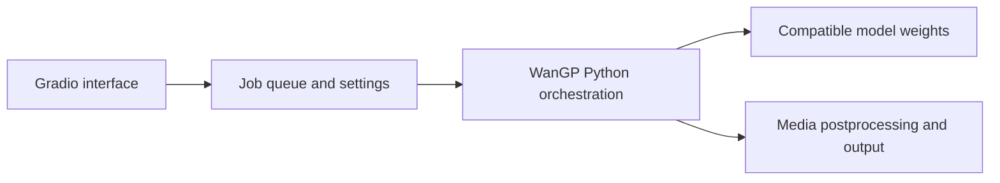

# Guide de consultation du fork WanGP / Wan2GP

**Upstream: [DeepBeepMeep / WanGP](https://github.com/deepbeepmeep/WanGP) · [README amont conservé dans ce fork](README.md) · [Licence applicable](LICENSE.txt)**

Ce dépôt est un fork GitHub de WanGP, dont le réseau de forks remonte à [Wan-Video/Wan2.1](https://github.com/Wan-Video/Wan2.1). Le moteur, les marques, crédits et technologies du projet amont ne sont pas revendiqués comme créations originales de ce compte.

## Périmètre technique inspecté

| Source | Rôle |
| --- | --- |
| [wgp.py](wgp.py) | Orchestration Python, interface Gradio, file d'attente et gestion des modèles |
| [requirements.txt](requirements.txt) | Dépendances Diffusers, Transformers, MMGP, FFmpeg et outils médias |
| [models/](models/) | Intégrations et configurations de modèles |
| [postprocessing/](postprocessing/) | Traitements de sortie |
| [Dockerfile](Dockerfile) | Environnement conteneurisé, sous réserve du matériel et des pilotes |

Les familles de modèles annoncées dans le README amont ne sont pas toutes exécutées ni livrées avec leurs poids dans le dépôt. Les exigences mémoire varient selon le modèle, la quantification, les réglages et le matériel ; aucun résultat GPU ou benchmark n'est établi par ce guide.

## Droits et licences

Le fichier [LICENSE.txt](LICENSE.txt) contient la **WanGP Community License 2.0**, et non une licence open source standard sans restrictions. Le texte prévoit l'usage gratuit et certaines redistributions sous conditions, ainsi que des restrictions de commercialisation du logiciel (notamment accès payant, marque blanche et intégration dans certains produits payants sans accord écrit). Les règles de crédit pour la vente ou la licence directe des créations et les licences propres aux modèles doivent être vérifiées avant diffusion. Le texte intégral de la licence prévaut sur ce résumé. Les notices amont et tierces restent intactes.

**Type :** moteur lourd de génération image/vidéo, à installer sur un ordinateur ou serveur doté des ressources nécessaires. Ce n'est pas une PWA exécutable sur GitHub Pages.

## Prise en main

1. Lire le README du dépôt, les instructions du modèle choisi et les licences associées.
2. Vérifier le GPU, la mémoire vidéo, le système d'exploitation, Python et les pilotes demandés.
3. Préparer un environnement isolé. Installer les dépendances uniquement à partir de sources de confiance.
4. Démarrer le moteur selon les scripts officiellement fournis (wgp.py, Docker ou scripts documentés).
5. Télécharger ou sélectionner un modèle compatible, dans le respect de ses conditions d'utilisation.
6. Exécuter une génération courte de validation, consulter les logs puis ajuster les paramètres.
7. Exporter les fichiers résultants et contrôler leurs métadonnées avant toute diffusion.

## Dépannage

- **GPU ou CUDA absent :** vérifier les pilotes et le backend pris en charge ; un hébergement web statique ne résout pas cette limitation.
- **Mémoire insuffisante :** réduire la résolution/la durée et consulter les réglages d'optimisation documentés.
- **Téléchargement bloqué :** vérifier les quotas, le fournisseur et le réseau.
- **Interfaces inaccessibles :** vérifier les ports locaux et les règles pare-feu sans exposer inutilement le service sur Internet.

Aucune génération accélérée n'est garantie sur un téléphone. Ne stockez pas de jetons dans des dépôts publics.

[Studio Niko Hub](https://studio-niko-hub.vercel.app/) · [README du fork](README.md)

## Qualification proposée / English overview

Verify the actual GPU, drivers, runtime and selected model license before installation. Record the exact commit, model, resolution, duration, memory and runtime for any authorized benchmark. Test an original synthetic prompt and output only after the environment is qualified. Do not expose an unauthenticated generation service to the internet.

This repository is an upstream WanGP fork, not a proprietary Studio Niko generation engine. No GPU generation, dependency installation, benchmark or deployment was performed in this documentation revision. The upstream README, software and license have not been altered.
